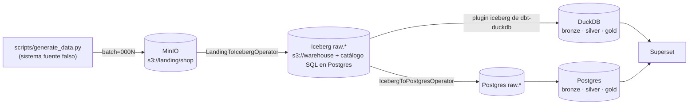
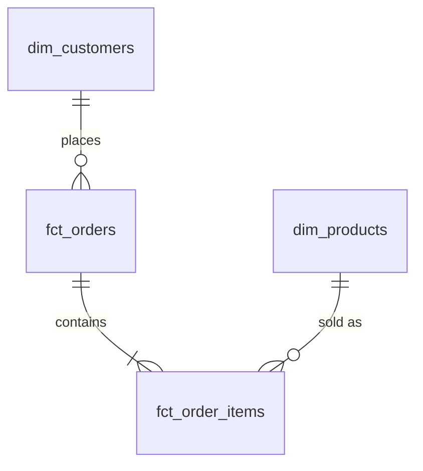

# Le Wagon · Lakehouse con Iceberg, dbt y tres orquestadores

Pipeline de punta a punta para clase:

**landing (JSONL/Parquet en MinIO) → _transfer operator_ → Apache Iceberg → dbt (bronze · silver · gold) en DuckDB y en Postgres → dashboards**

La lógica de negocio es la misma en todas las ramas; lo único que cambia es el orquestador y la herramienta de BI:

| Rama | Orquestador | dbt | BI |
|---|---|---|---|
| `main` | **Airflow 3.3** (Astro CLI) | Cosmos (`DbtTaskGroup`) | **Superset** |
| `prefect` | **Prefect 3** | `prefect-dbt` (`PrefectDbtRunner`) | **Streamlit** |
| `kestra` | **Kestra** | `io.kestra.plugin.dbt.cli.DbtCLI` | **Metabase** |

Todo se maneja con `just` (`just` a secas lista las recetas).

---

## Arquitectura



* **Transfer operator** (`include/operators/transfers.py`): `LandingToIcebergOperator` sigue la convención de los providers de Airflow (`<Origen>To<Destino>Operator`). Toda la lógica está en `include/lakehouse/` (pyarrow + fsspec + pyiceberg, sin pandas) para que Prefect y Kestra ejecuten exactamente el mismo código.
* **Iceberg**: catálogo SQL de pyiceberg guardado en Postgres; datos y metadata en MinIO. Cada batch = un snapshot (con la propiedad `lakehouse.batch-id`), lo que da idempotencia y _time travel_ por batch.
* **Dos motores, un proyecto dbt** (`include/dbt/shop`, targets `duckdb` y `postgres`):
  * DuckDB lee Iceberg **directo** → estilo _lakehouse_.
  * Postgres no lee Iceberg → se **copia** el snapshot actual al esquema `raw` → estilo _warehouse_ clásico.

### Medallion

| Capa | Qué hace | Modelos |
|---|---|---|
| **bronze** | Dedup: última versión de cada clave de negocio (por `updated_at`, desempate por `_ingested_at`). Los deletes quedan marcados con `is_deleted`. | `bronze_customers`, `bronze_products`, `bronze_orders`, `bronze_order_items` |
| **silver** | Entidades del ERD con FKs testeadas. PII enmascarada para clientes borrados. | `dim_customers`, `dim_products`, `fct_orders`, `fct_order_items` |
| **gold** | Tablas agregadas para los dashboards. | `gold_daily_revenue`, `gold_customer_lifetime_value`, `gold_product_performance`, `gold_revenue_by_country_tier`, `gold_order_status_funnel` |



---

## Requisitos

* Docker, [Astro CLI](https://www.astronomer.io/docs/astro/cli/install-cli), [uv](https://docs.astral.sh/uv/), [just](https://just.systems)
* ~6 GB de RAM libres para Docker

## Arranque rápido

```bash
just setup        # crea .env
just up           # Airflow + MinIO + Postgres + Superset + Jupyter + Streamlit
just demo-initial # genera el batch inicial, dispara la ingesta y arma los dashboards de Superset
```

`lakehouse_ingest` actualiza el asset `iceberg_raw`, y eso dispara solos `lakehouse_dbt_duckdb` y `lakehouse_dbt_postgres`.

| Servicio | URL | Usuario |
|---|---|---|
| Airflow | http://localhost:8080 | — |
| MinIO | http://localhost:9001 | minio / minio123 |
| Superset | http://localhost:8088 | admin / admin |
| Postgres (warehouse) | localhost:5433 | lakehouse / lakehouse |
| Jupyter | http://localhost:8888 | sin token |
| Streamlit | http://localhost:8501 (y dentro de Airflow) | — |

---

## Guion de clase

Cada demo genera un batch con id fijo y dispara la ingesta. Después de cada uno, mirá Airflow, Iceberg y los dashboards.

| # | Comando | Qué pasa | Cómo verlo |
|---|---|---|---|
| 1 | `just demo-initial` | Primer batch: 200 clientes, 40 productos, 1000 pedidos. Se crean las tablas Iceberg. | `just tables` · `just snapshots customers` |
| 2 | `just demo-updates` | Updates (emails, países, estados de pedido, precios), 3 deletes (GDPR) y 5 filas duplicadas exactas. `raw` crece; `bronze` sigue con 1 fila por clave. | `just dedup-check` · `just history customers "customer_id = 7"` · `just time-travel customers` |
| 3 | `just demo-schema-evolution` | La fuente pasa a exportar Parquet: aparece `loyalty_tier` en customers y `quantity` pasa de `int` a `long`. Iceberg evoluciona el esquema sin reescribir datos. | `just schema-history customers` · `just schema order_items` · gold `gold_revenue_by_country_tier` deja de decir `unknown` |
| 4 | `just demo-late-arriving` | Llegan eventos **viejos** después de los nuevos. Bronze debe ignorarlos porque ordena por `updated_at`. | Test singular `assert_bronze_dedup_keeps_latest` en verde · `gold_order_status_funnel` no cambia |
| 5 | `just demo-idempotency` | Re-ejecutar un batch ya cargado no escribe nada (snapshot property). | Log del task: `batches_skipped=['0001']` · `just snapshots` sin snapshot nuevo |
| 6 | `just nuke && just up && just demo-upsert` | Mismos batches 1 y 2 pero con `table.upsert()` (merge por PK) en vez de append, en un stack limpio. Discutir: ¿historia en raw o estado actual? | `just snapshots orders` (operación `overwrite`/`delete`) |

`just demo-all` corre 1→4 con pausas.

### Puntos para discutir

* **Append + dedup en bronze vs. upsert en raw.** Append conserva la historia (auditoría, _time travel_, reprocesar); upsert simplifica bronze pero pierde eventos intermedios.
* **Contratos de esquema.** El operador acepta columnas nuevas y promociones seguras (`int→long`, `float→double`). Un cambio incompatible (p. ej. `customer_id` pasa a string) **falla a propósito** (ver `test_incompatible_type_change_fails_loudly`).
* **Schema evolution aguas abajo.** Los modelos son SQL plano. `bronze_customers` expone `loyalty_tier` siempre (en `null` hasta que llega la columna, con un `` visible en el modelo) y `dim_customers` la completa con `'unknown'`, así `silver` y `gold` funcionan antes y después del cambio.
* **DuckDB vs Postgres.** Mismos modelos, mismos números (`just compare`), dos formas de leer Iceberg.

---

## Tests

| Comando | Qué prueba |
|---|---|
| `just test` | Lógica de ingesta sin Docker (catálogo SQLite + archivos locales): carga inicial, idempotencia, historia + time travel, columna nueva, `int→long`, upsert, cambio incompatible. |
| `just test-dags` | Integridad de los DAGs dentro de la imagen de Astro. |
| `just test-dbt` | Unit test de dbt (`gold_daily_revenue`) + data tests (unique, not_null, relationships, accepted_values, dedup) en ambos motores. |

## Superset

Al arrancar ya están creadas las conexiones **Warehouse Postgres** y **Warehouse DuckDB** (solo lectura). `just demo-initial` (o `just superset-setup`) crea los dashboards **Shop · Executive** y **Shop · Operations** sobre las tablas `gold.*`. Ver [`docs/superset.md`](docs/superset.md).

> DuckDB admite un solo escritor: si Superset da error de _lock_ mientras corre dbt, esperá a que termine el DAG y refrescá.

## Dashboard de Streamlit dentro de Airflow (plugin)

`plugins/lakehouse_dashboard.py` es un plugin de Airflow 3 que agrega una *external view*: aparece
**Lakehouse dashboard** en la barra lateral de Airflow y muestra embebida (iframe) la app de
Streamlit `dashboard/app.py`, que lee las tablas gold de DuckDB o de Postgres (se elige en la barra
lateral). `just dashboard` la abre en http://localhost:8080/plugin/lakehouse-dashboard.

* El plugin no contiene lógica: solo le dice a Airflow dónde vive la app (`href`) y en qué ruta
  embeberla (`url_route`). Airflow carga los plugins al arrancar: después de tocarlo, `just up`.
* `dashboard/` está montado en el contenedor: si editás `app.py`, la página se recarga sola.

## Jupyter

`notebooks/explore_lakehouse.ipynb` (`just notebook`): consultas con `jupysql` a Postgres y DuckDB,
archivos de MinIO con `s3fs` + `pyarrow`, DuckDB leyendo MinIO con `httpfs` y time travel con
`pyiceberg`. `just notebook-check` ejecuta todo el notebook para verificar que sigue andando.

## Estructura

```
├── dags/                      # Airflow: ingest + dbt DuckDB + dbt Postgres
├── include/
│   ├── lakehouse/             # lógica compartida (sin orquestador)
│   ├── operators/transfers.py # LandingToIcebergOperator, IcebergToPostgresOperator
│   ├── dbt/shop/              # proyecto dbt (bronze/silver/gold, 2 targets)
│   └── data/                  # warehouse.duckdb (ignorado por git)
├── plugins/                   # plugin de Airflow: dashboard de Streamlit embebido
├── dashboard/                 # app de Streamlit sobre gold (DuckDB / Postgres)
├── notebooks/                 # Jupyter: jupysql, MinIO, pyiceberg
├── scripts/                   # generador de datos, inspector de Iceberg, setup de Superset
├── infra/                     # init de Postgres/MinIO, imágenes de Superset y Jupyter
├── tests/                     # pytest (ingesta) + integridad de DAGs
├── docker-compose.override.yml
└── justfile
```

## Versiones

Astro Runtime 3.3 (Airflow 3.3) · astronomer-cosmos ≥ 1.15 · pyiceberg ≥ 0.11.1 · dbt-core 1.x + dbt-duckdb + dbt-postgres · DuckDB ≥ 1.5.4 · Postgres 18.

> dbt Fusion (v2) todavía no se usa acá: Cosmos y el plugin de Iceberg de dbt-duckdb corren sobre dbt Core.
