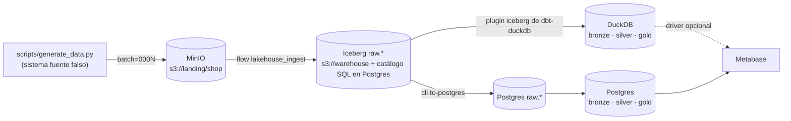
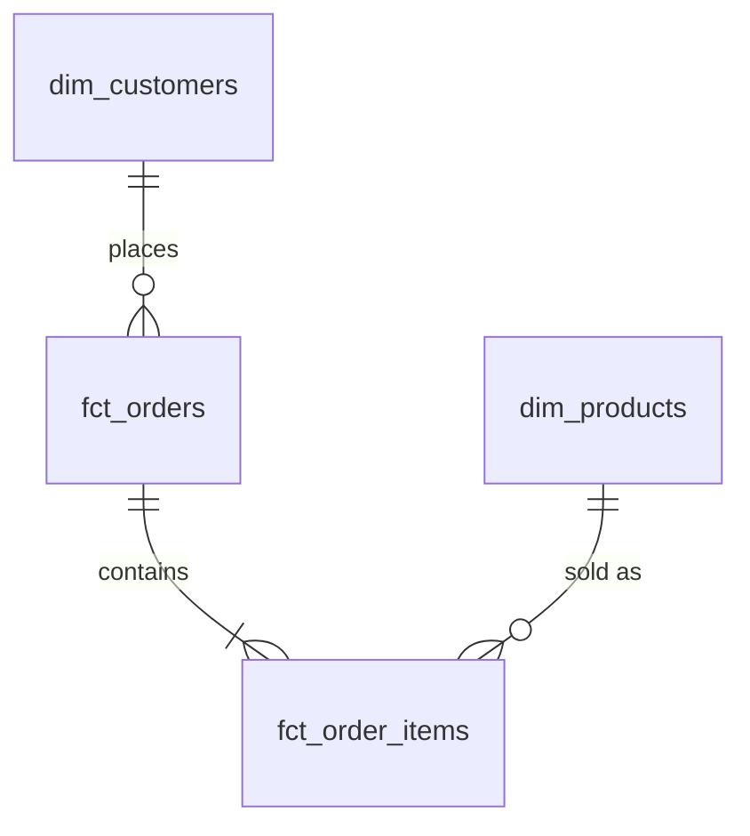

# Le Wagon · Lakehouse con Iceberg, dbt y tres orquestadores · rama `kestra`

Pipeline de punta a punta para clase:

**landing (JSONL/Parquet en MinIO) → _transfer operator_ → Apache Iceberg → dbt (bronze · silver · gold) en DuckDB y en Postgres → dashboards**

La lógica de negocio es la misma en todas las ramas; lo único que cambia es el orquestador y la herramienta de BI:

| Rama | Orquestador | dbt | BI |
|---|---|---|---|
| `main` | **Airflow 3.3** (Astro CLI) | Cosmos (`DbtTaskGroup`) | **Superset** |
| `prefect` | **Prefect 3** | `prefect-dbt` (`PrefectDbtRunner`) | **Streamlit** |
| `kestra` ← **estás acá** | **Kestra** | `io.kestra.plugin.dbt.cli.DbtCLI` | **Metabase** |

Todo se maneja con `just` (`just` a secas lista las recetas).

> 👩‍🎓 **Estudiantes: empiecen por la [guía práctica](docs/guia-estudiantes.md)**: recorrido por cada sistema (MinIO, Kestra, Iceberg, dbt, Postgres, DuckDB, Metabase, Jupyter), laboratorio con los 4 escenarios y desafíos. Para comparar los tres orquestadores (o correrlos a la vez): [guía de orquestadores](https://github.com/aoelvp94/lewagon-iceberg-lakehouse/blob/main/docs/orquestadores.md).

---

## Arquitectura



* **Transfer**: en `main` es el `LandingToIcebergOperator` de Airflow; acá es un comando, `python -m include.lakehouse.cli ingest --entity …`, que llama a la misma función (`include/lakehouse/ingest.py`, pyarrow + fsspec + pyiceberg, sin pandas).
* **Flows Kestra** (`flows/*.yml`, namespace `lewagon.lakehouse`), sincronizados solos desde la carpeta:
  * `lakehouse_ingest`: `prepare_catalog` (crea el catálogo una sola vez) y un `ForEach` sobre las 4 entidades, en paralelo.
  * `lakehouse_dbt_duckdb` y `lakehouse_dbt_postgres`: arrancan con un **Flow trigger** cuando la ingesta termina en `SUCCESS` (equivalente a los Assets de Airflow).
* Cada task corre en un contenedor `lakehouse-runner:local` (Docker task runner) con el repo montado en `/app`: Kestra orquesta y el código sigue siendo el mismo.
* **Iceberg**: catálogo SQL de pyiceberg guardado en Postgres; datos y metadata en MinIO. Cada batch = un snapshot (con la propiedad `lakehouse.batch-id`), lo que da idempotencia y _time travel_ por batch.
* **Dos motores, un proyecto dbt** (`include/dbt/shop`, targets `duckdb` y `postgres`):
  * DuckDB lee Iceberg **directo** → estilo _lakehouse_.
  * Postgres no lee Iceberg → se **copia** el snapshot actual al esquema `raw` → estilo _warehouse_ clásico.

### Medallion

| Capa | Qué hace | Modelos |
|---|---|---|
| **bronze** | Dedup: última versión de cada clave de negocio (por `updated_at`, desempate por `_ingested_at`). Los deletes quedan marcados con `is_deleted`. | `bronze_customers`, `bronze_products`, `bronze_orders`, `bronze_order_items` |
| **silver** | Entidades del ERD con FKs testeadas. PII enmascarada para clientes borrados. | `dim_customers`, `dim_products`, `fct_orders`, `fct_order_items` |
| **gold** | Tablas agregadas para los dashboards. | `gold_daily_revenue`, `gold_customer_lifetime_value`, `gold_product_performance`, `gold_revenue_by_country_tier`, `gold_order_status_funnel` |



---

## Requisitos

* Docker, [uv](https://docs.astral.sh/uv/), [just](https://just.systems), curl
* ~6 GB de RAM libres para Docker

## Arranque rápido

```bash
just up             # Kestra + MinIO + Postgres + Metabase + Jupyter (+ imagen de tareas)
just check          # ✔ / ✘ por cada sistema y cada capa de datos
just demo-initial   # batch inicial → lakehouse_ingest → los 2 flows de dbt → dashboards de Metabase
```

`just ingest` (y todos los `just demo-*`) ejecuta `lakehouse_ingest` y **espera** también a los dos flows de dbt que dispara su Flow trigger (`scripts/kestra_run.py`).

| Servicio | URL | Usuario |
|---|---|---|
| Kestra | http://localhost:8080 | admin@kestra.io / Admin1234 |
| Metabase | http://localhost:3000 | admin@lewagon.example / LeWagon2026! |
| MinIO | http://localhost:9001 | minio / minio123 |
| Postgres (warehouse) | localhost:5433 | lakehouse / lakehouse |
| Jupyter | http://localhost:8888 | sin token |

> **¿Airflow (`main`) o Prefect corriendo al mismo tiempo?** `just side-by-side` mueve todos los puertos de este stack a 2xxxx (Kestra :28080, Metabase :23000, MinIO :29001, Postgres :25433, Jupyter :28888) y `just default-ports` los vuelve a los estándar.

---

## Guion de clase

Cada demo genera un batch con id fijo y dispara la ingesta. Después de cada uno, mirá Kestra (Executions → Gantt / Logs), Iceberg y Metabase.

| # | Comando | Qué pasa | Cómo verlo |
|---|---|---|---|
| 1 | `just demo-initial` | Primer batch: 200 clientes, 40 productos, 1000 pedidos. Se crean las tablas Iceberg. | `just tables` · `just snapshots customers` |
| 2 | `just demo-updates` | Updates (emails, países, estados de pedido, precios), 3 deletes (GDPR) y 5 filas duplicadas exactas. `raw` crece; `bronze` sigue con 1 fila por clave. | `just dedup-check` · `just history customers "customer_id = 7"` · `just time-travel customers` |
| 3 | `just demo-schema-evolution` | La fuente pasa a exportar Parquet: aparece `loyalty_tier` en customers y `quantity` pasa de `int` a `long`. Iceberg evoluciona el esquema sin reescribir datos. | `just schema-history customers` · `just schema order_items` · gold `gold_revenue_by_country_tier` deja de decir `unknown` |
| 4 | `just demo-late-arriving` | Llegan eventos **viejos** después de los nuevos. Bronze debe ignorarlos porque ordena por `updated_at`. | Test singular `assert_bronze_dedup_keeps_latest` en verde · `gold_order_status_funnel` no cambia |
| 5 | `just demo-idempotency` | Re-ejecutar un batch ya cargado no escribe nada (snapshot property). | Outputs de `landing_to_iceberg`: `batches_skipped` con `0001` · `just snapshots` sin snapshot nuevo |
| 6 | `just nuke && just up && just demo-upsert` | Mismos batches 1 y 2 pero con `table.upsert()` (merge por PK) en vez de append, en un stack limpio. Discutir: ¿historia en raw o estado actual? | `just snapshots orders` (operación `overwrite`/`delete`) |

`just demo-all` corre 1→4 con pausas.

### Puntos para discutir

* **Append + dedup en bronze vs. upsert en raw.** Append conserva la historia (auditoría, _time travel_, reprocesar); upsert simplifica bronze pero pierde eventos intermedios.
* **Contratos de esquema.** El operador acepta columnas nuevas y promociones seguras (`int→long`, `float→double`). Un cambio incompatible (p. ej. `customer_id` pasa a string) **falla a propósito** (ver `test_incompatible_type_change_fails_loudly`).
* **Schema evolution aguas abajo.** Los modelos son SQL plano. `bronze_customers` expone `loyalty_tier` siempre (en `null` hasta que llega la columna, con un `` visible en el modelo) y `dim_customers` la completa con `'unknown'`, así `silver` y `gold` funcionan antes y después del cambio.
* **DuckDB vs Postgres.** Mismos modelos, mismos números (`just compare`), dos formas de leer Iceberg.

---

## Tests

| Comando | Qué prueba |
|---|---|
| `just test` | Lógica de ingesta sin Docker (catálogo SQLite + archivos locales): carga inicial, idempotencia, historia + time travel, columna nueva, `int→long`, upsert, cambio incompatible. |
| `just test-dbt` | Unit test de dbt (`gold_daily_revenue`) + data tests (unique, not_null, relationships, accepted_values, dedup) en ambos motores. |

## Metabase

`just metabase-setup` (lo corre `just demo-initial`) crea el admin, la conexión **Warehouse Postgres** y los mismos dos dashboards que Superset en `main`, con SQL nativo sobre `gold` (idempotente: se puede volver a correr):

* **Shop · Executive**: revenue, órdenes, ticket promedio, clientes activos; revenue diario; revenue por país × loyalty tier; top 10 clientes.
* **Shop · Operations**: órdenes por estado; revenue por categoría; unidades por día; performance por producto.

Para comparar con DuckDB: `just metabase-duckdb-driver` descarga el driver comunitario de MotherDuck y `just metabase-setup` agrega **Warehouse DuckDB** (solo lectura). Es opcional: Metabase no trae DuckDB de fábrica.

## Jupyter

`notebooks/explore_lakehouse.ipynb` (`just notebook`): consultas con `jupysql` a Postgres y DuckDB, archivos de MinIO con `s3fs` + `pyarrow`, DuckDB leyendo MinIO con `httpfs` y time travel con `pyiceberg`. `just notebook-check` ejecuta todo el notebook para verificar que sigue andando.

## Airflow vs Kestra (para la discusión)

| | Airflow (`main`) | Kestra (esta rama) |
|---|---|---|
| Definición | Python (DAGs) | YAML declarativo |
| Código de negocio | operador custom en el proceso de Airflow | comandos en contenedores (Docker task runner) |
| Fan-out por entidad | dynamic task mapping (`.partial().expand()`) | `ForEach` + `concurrencyLimit` |
| Encadenar dbt | Assets | Flow trigger con `preconditions` |
| dbt | Cosmos: 1 task por modelo | `DbtCLI`: un `dbt build` (logs por modelo en la UI) |
| Concurrencia DuckDB | `max_active_tasks=1` | `concurrency.limit: 1` |

## Estructura

```
├── flows/                     # Kestra: ingest, dbt DuckDB, dbt Postgres (YAML)
├── runner/                    # imagen donde corre cada task de Kestra
├── include/
│   ├── lakehouse/             # lógica compartida (+ cli.py para orquestadores "de comandos")
│   ├── dbt/shop/              # proyecto dbt (bronze/silver/gold, 2 targets)
│   └── data/                  # warehouse.duckdb (ignorado por git)
├── scripts/                   # generador, inspector de Iceberg, setup de Metabase, kestra_run (uv)
├── notebooks/                 # Jupyter: jupysql, MinIO, pyiceberg
├── infra/                     # init de Postgres/MinIO, plugins de Metabase, imagen de Jupyter
├── tests/                     # pytest (ingesta)
├── docker-compose.yml
└── justfile
```

## Versiones

Kestra 2.0 · plugin dbt `DbtCLI` · Metabase v0.65 · pyiceberg ≥ 0.11.1 · dbt-core 1.x + dbt-duckdb + dbt-postgres · DuckDB ≥ 1.5.4 · Postgres 18.

> **Antes de la clase:** la imagen de Kestra pesa ~11 GB (trae todos los plugins): hacé `just up` una vez con buena conexión. Kestra y Metabase corren con `JAVA_OPTS=-Xmx1g` para que entren en una laptop junto a otros stacks.

> **Kestra 2.0:** los flows usan `io.kestra.plugin.core.flow.Loop` (antes `ForEach`, con `{{ item.value }}`) y el Flow trigger con `dependsOn` (antes `preconditions`). Ya no hay `pluginDefaults` a nivel flow, por eso cada task declara su `containerImage` y `taskRunner`. `just up` publica los flows por la API (`just deploy`); después de editar un flow, `just deploy`.

> dbt Fusion (v2) todavía no se usa acá: el plugin de Iceberg de dbt-duckdb corre sobre dbt Core.
